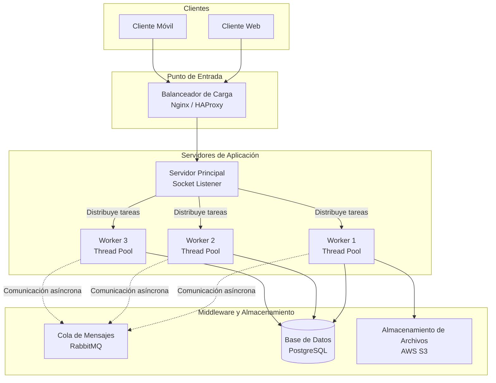

# 🌐 PfoTresRedes: Rediseño como Sistema Distribuido (Cliente-Servidor)

> Proyecto final que transforma un sistema monolítico en una arquitectura distribuida utilizando **sockets en Python**, con un servidor que distribuye tareas a un pool de workers y clientes que envían/reciben resultados en tiempo real.

---

## 🎯 Objetivo

Implementar una arquitectura **cliente-servidor distribuida** donde:
- Un servidor central recibe tareas a través de **sockets TCP**.
- Las tareas se distribuyen a un **pool de workers** (hilos) para procesamiento paralelo.
- Los clientes pueden enviar tareas y recibir resultados de forma síncrona.

---

## 🏗️ Arquitectura del Sistema

El siguiente diagrama representa la arquitectura completa del sistema distribuido:



> 💡 **Nota:** Si el diagrama no se renderiza en tu vista previa de GitHub, puedes visualizarlo en [Mermaid Live Editor](https://mermaid.live/).

---

## 🛠️ Tecnologías Utilizadas

| Componente | Tecnología | Función |
|------------|------------|---------|
| Lenguaje | Python 3.x | Implementación del servidor y cliente |
| Comunicación | Sockets TCP (librería `socket`) | Conexión cliente-servidor |
| Concurrencia | `concurrent.futures` | Pool de workers (hilos) |
| Serialización | `json` | Intercambio de datos estructurados |
| Diagrama | Mermaid.js | Documentación de arquitectura |

---

## 📂 Estructura del Proyecto

```
PfoTresRedes/
├── server.py          # Servidor con pool de workers
├── client.py          # Cliente que envía tareas
├── requirements.txt   # Dependencias (opcional)
├── README.md          # Este archivo
└── .gitignore         # Archivos ignorados por Git
```

---

## 🚀 Cómo Ejecutar el Proyecto

### 1. Clonar el repositorio

```bash
git clone https://github.com/Carloslovera/PfoTresRedes.git
cd PfoTresRedes
```

### 2. Ejecutar el servidor

Abre una terminal y ejecuta:

```bash
python server.py
```

Deberías ver:
```
[*] Servidor escuchando en 127.0.0.1:65432...
```

### 3. Ejecutar el cliente

En **otra terminal**, ejecuta:

```bash
python client.py
```

Deberías ver:
```
[*] Enviando tarea TASK-001 al servidor...
[✓] Respuesta del servidor: exitoso
    Detalle: Tarea TASK-001 completada con éxito. Datos procesados.
```

---

## 📊 Ejemplo de Salida

### Servidor
```
[*] Servidor escuchando en 127.0.0.1:65432...
[Servidor] Conexión establecida con ('127.0.0.1', 54321)
[Worker] Procesando tarea TASK-001: Procesar imagen de usuario y subir a S3
[Servidor] Conexión cerrada con ('127.0.0.1', 54321)
```

### Cliente
```
[*] Enviando tarea TASK-001 al servidor...
[✓] Respuesta del servidor: exitoso
    Detalle: Tarea TASK-001 completada con éxito. Datos procesados.
```

---

## 🧠 Decisiones de Diseño

1. **Uso de `ThreadPoolExecutor`**: Se implementó un pool de hilos para simular los workers del diagrama arquitectónico. Esto permite procesar múltiples tareas en paralelo sin bloquear el servidor principal.

2. **Comunicación por JSON**: Los datos se serializan en formato JSON para facilitar la interoperabilidad entre cliente y servidor, independientemente del lenguaje de implementación.

3. **Manejo de errores**: Se incluyen excepciones para conexiones rechazadas, timeouts y datos inválidos, garantizando robustez en la comunicación.

4. **Arquitectura escalable**: El diseño permite agregar más workers o balanceadores de carga sin modificar la lógica del cliente.

---

## 🔄 Posibles Mejoras Futuras

- [ ] Integrar **RabbitMQ** para comunicación asíncrona entre workers.
- [ ] Conectar con **PostgreSQL** para persistencia de tareas.
- [ ] Subir archivos procesados a **AWS S3**.
- [ ] Implementar un balanceador de carga real con **Nginx**.
- [ ] Agregar contenedores **Docker** para despliegue.
- [ ] Crear una API REST con **FastAPI** como capa adicional.

---

## 👤 Autor

**[Carlos Lovera]**  
📧 [carloslovera1314@gmail.com]   
🐙 [GitHub] https://github.com/Carloslovera/PfoTresRedes.git 

---

## 📄 Licencia

Este proyecto fue desarrollado como parte de la evaluación **PFO 3 - Rediseño como Sistema Distribuido**.

---

<div align="center">

**¿Te gustó el proyecto?** ¡Déjame una ⭐ en el repositorio!

</div>